# pathfinder 피치덱

12장이다. 깃허브에서는 아래로 내리면서 본다.

화살표 키나 손가락으로 한 장씩 넘겨 보려면 [`deck.html`](deck.html)을 브라우저로 연다.
저장소를 받아서 `python3 -m http.server 8765 --bind 127.0.0.1`을 실행하고 `http://localhost:8765/deck.html`을 열면 된다.

## 1. 표지

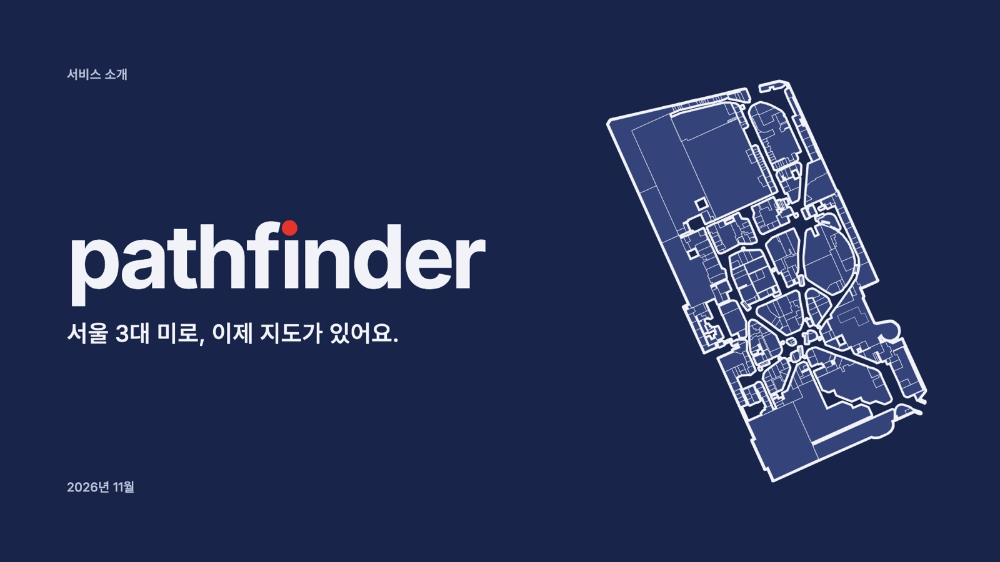

## 2. 문제

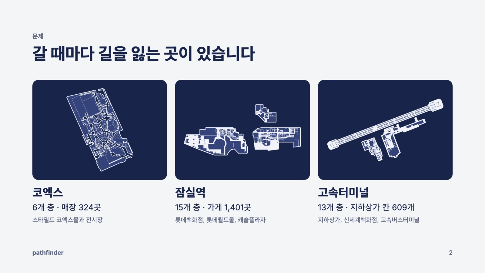

## 3. 원인

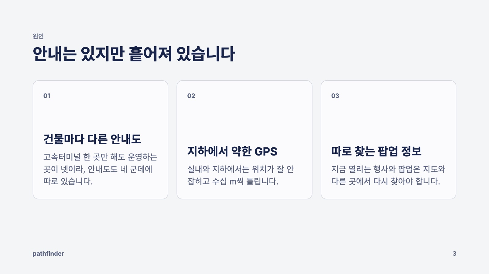

## 4. 해결

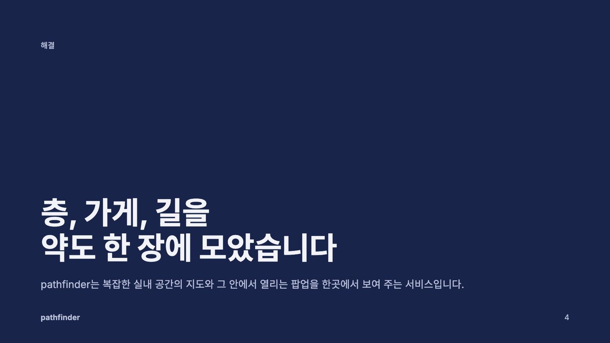

## 5. 제품

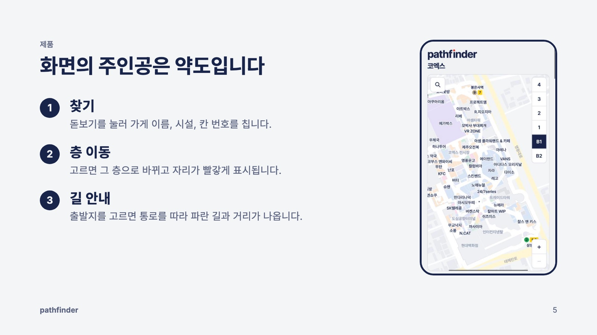

## 6. 현황

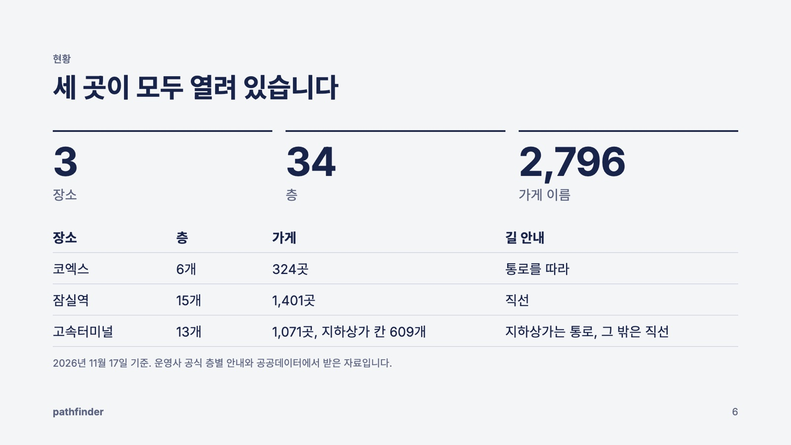

## 7. 만드는 방식

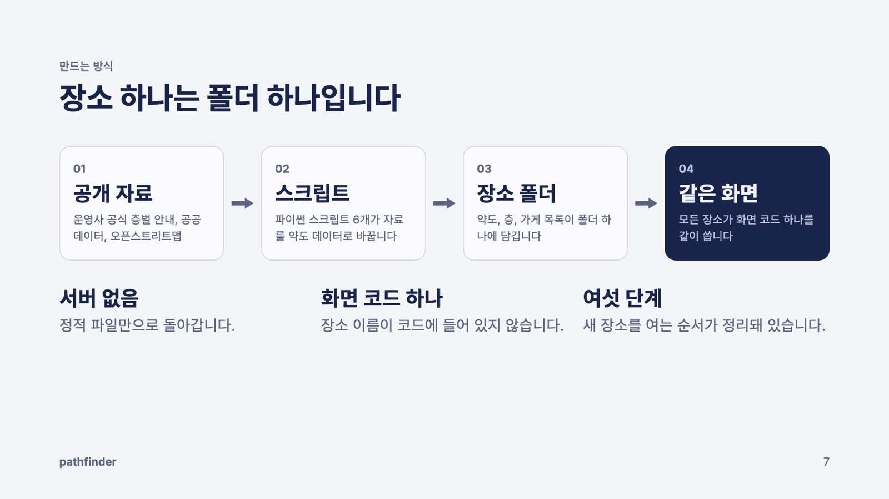

## 8. 다음 단계

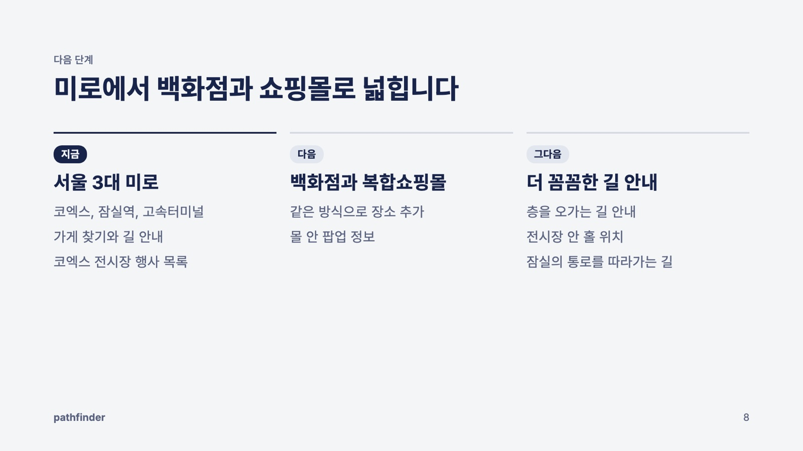

## 9. 수익 모델

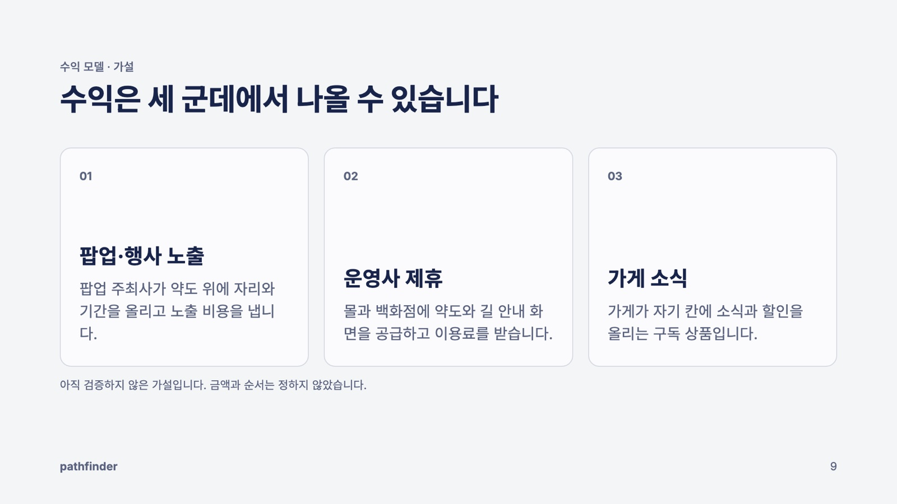

## 10. 팀

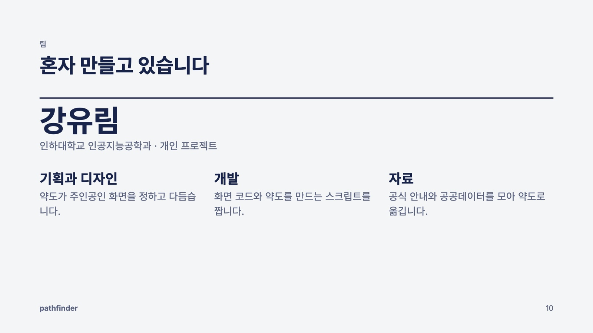

## 11. 필요한 것

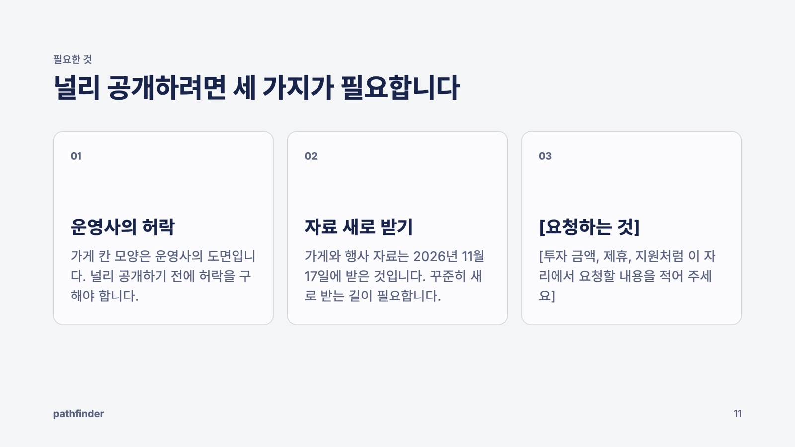

## 12. 마무리

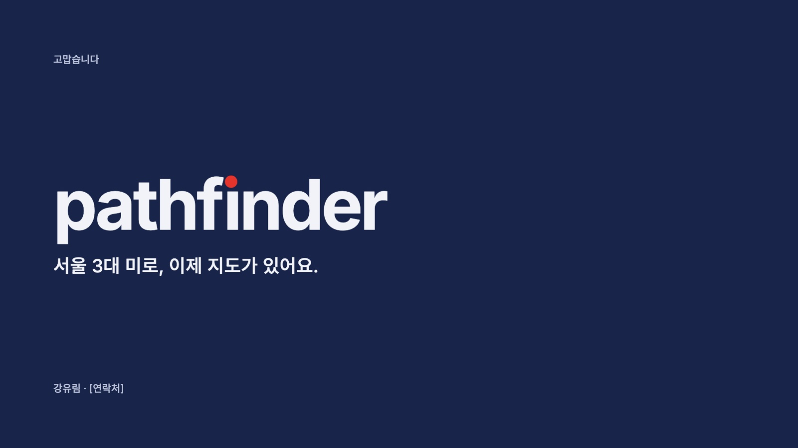

---

원본은 [claude.ai 슬라이드](https://claude.ai/artifact/QYWtdXBo1rJ9773Btuy9Jy)에 있고 만든 사람만 열 수 있다.
원본을 고치면 `deck.html`과 `docs/deck/`의 그림을 다시 옮겨야 한다. 여기 있는 것은 2026-11-17에 옮긴 것이다.
